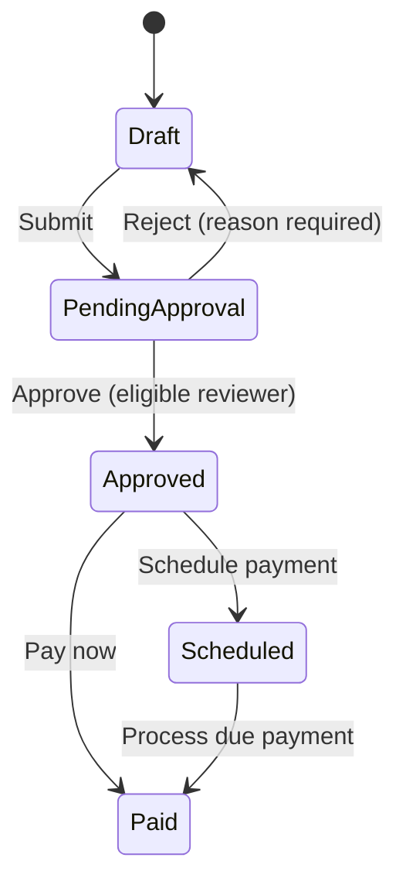

# Bill Lifecycle State Machine

Last reviewed: 2026-10-14

## Scope and evidence

This model records the bill lifecycle described in accessible product
documentation and summarized in the [demo overview](demo-overview.md). The
physical implementation and transition guards are not visible to this
repository. The diagram describes documented business flow, not verified
server enforcement. Any state shown in the UI is browser-visible evidence
only.

“Rejected” is an activity event, not a current bill status. A rejection
returns the bill to Draft and shows a “Needs revision” indicator. “Overdue”
is a derived display marker on qualifying unpaid bills, not a separate
lifecycle state. Product documentation also describes recurring upfront-
approved generation of Scheduled bills; that route is a special creation
path and has not been independently exercised.

## Documented transition rules

| Current state | Action | Next state / visible result | Role or data rule | Evidence and status |
|---|---|---|---|---|
| Draft | Submit | Pending approval; awaiting role displayed | Bill capture roles may submit; routing follows the selected approval threshold | Product docs and demo overview. No submission transition executed in this project. |
| Pending approval | Approve | Approved | AP Manager may decide an AP Manager queue; Controller may decide either queue; creator may not decide own bill | Product docs and RBAC matrix. No approval executed. |
| Pending approval | Reject with a reason | Draft with “Needs revision”; rejection appears as activity | Eligible reviewer; non-empty reason required | Product docs and demo overview. No rejection executed. |
| Approved | Schedule payment | Scheduled | AP Manager or Controller; supported method/date required | Product docs and demo overview. No scheduling executed. |
| Approved | Pay now | Paid | AP Manager or Controller | Product docs and demo overview. No payment executed. |
| Scheduled and due | Process due | Paid | AP Manager or Controller can initiate the UI action; scheduled job is documented at 13:00 UTC | Product docs and demo overview. Neither UI run nor cron executed. |

## Unknown or conditional transitions

No general transition is declared invalid here solely because it is absent
from the documented happy path. Specific invalid-state and stale-revision
behavior requires a controlled, authorized test interface. Do not try
unsupported UI actions, replay private requests, or manipulate shared
records to create stale states.

The following remain conditional:

- Duplicate approval/payment actions, stale revisions, and concurrent
  decisions require isolated test data and a controlled server interface.
- Failure rollback and atomicity require authoritative state observation
  under a documented safe failure trigger.
- Recurring generation and cron execution require an isolated series,
  controlled time, and safe reset/inspection mechanisms.
- Server-side role enforcement requires distinct authenticated users;
  the demo role switcher is not an identity boundary.

See the [API/server strategy](api-server-test-strategy.md) and
[database strategy](database-validation-strategy.md) for access gates.

## Current UI coverage

`STATE-001` is a read-only snapshot of the known seeded bill ACME-10501:
it checks Pending approval, awaiting AP Manager, and the visible Created
and Submitted for approval timeline events. The record was confirmed in
that state on 2026-10-14, and the check passed that day. This is a
state-display check, not evidence that
the transition was correctly persisted or that activity is complete.

The actual transition scenarios remain conditional under the
[test-data strategy](test-data-strategy.md): creating, submitting,
approving, rejecting, scheduling, or paying bills can change shared demo
state, and no safe cleanup path is established.

